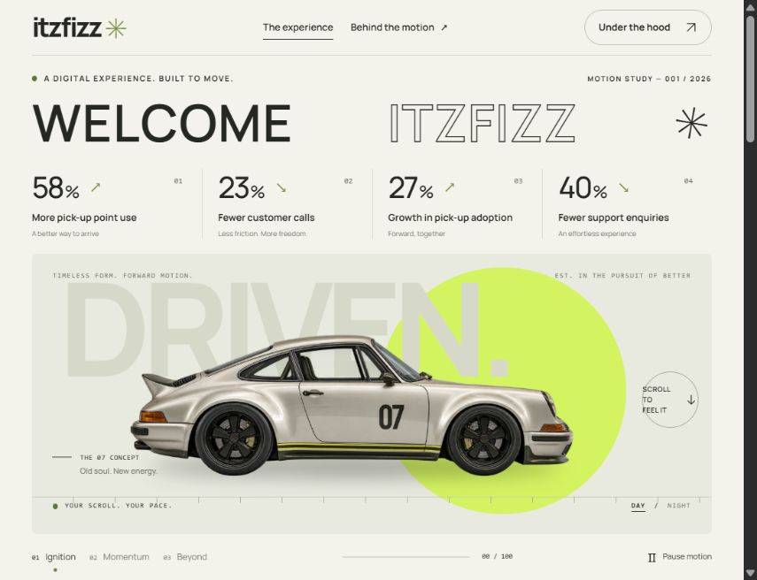

# ITZFIZZ — Driven by the extraordinary

A scroll-driven hero built with **Next.js, React, TypeScript, Tailwind CSS, and GSAP ScrollTrigger**. A custom silver coupe moves through an editorial scene with an ivory-and-lime palette, oversized typography, and a reversible, three-part scroll journey.



**Repository:** https://github.com/akshatXD-hash/ui-herosection

**Live URL:** Add your deployed URL here before submitting the assignment. This repository does not deploy automatically.

## Run locally

Use Node.js 22 or later and npm.

```sh
npm ci
npm run dev
```

Open http://127.0.0.1:3000. Fonts and the car image are served locally; there are no runtime image services, API keys, or third-party font requests.

## What to try

- Watch the staggered headline and metric entrance.
- Scroll down to move the car, shift the backdrop, and reveal the closing message. Scroll back up to reverse the entire sequence.
- Use **Ignition / Momentum / Beyond** to navigate the sequence with a mouse or keyboard.
- Switch between **Day / Night** scenes.
- Use **Pause motion** for a static experience, or enable your operating system's reduced-motion preference. This removes the extended scroll runway and disables the animation.
- Follow **Behind the motion**, then use **Take it for another spin** to return to the beginning.
- Keep scrolling below the hero: the story heading reveals line by line, oversized text moves in opposing directions, and the three principle illustrations respond to your scroll. These effects also respect motion-off and system reduced-motion preferences.

## Assignment coverage

| Requirement            | Implementation                                                                           |
| ---------------------- | ---------------------------------------------------------------------------------------- |
| First-screen hero      | A viewport-height scene with the headline and four impact metrics above the visual       |
| Letter-spaced headline | Accessible “WELCOME ITZFIZZ” heading with individually staggered letters                 |
| Initial load animation | GSAP fade/translate entrance for the headline; sequential metric reveals                 |
| Scroll-driven visual   | CSS sticky scene and a GSAP ScrollTrigger timeline with `scrub: 0.9`                     |
| Smooth movement        | Transform-based translation and scale, parallax, and a short scrub interpolation         |
| Performance            | ~199 KiB WebP, local fonts, no React state updates or layout reads inside the frame loop |
| Mandatory stack        | Next.js App Router, React, semantic HTML, CSS, TypeScript/JavaScript, Tailwind 4, GSAP   |
| Responsive behavior    | Desktop, tablet, phone, and compact-height layouts                                       |
| Accessibility          | Named controls, focus styles, skip link, meaningful image alternative, motion controls   |

Bootstrap and WordPress are optional in the brief and are not needed for this implementation.

## How the motion works

The outer section provides a `310svh` runway. The inner hero stays in place using `position: sticky`. ScrollTrigger maps the runway's scroll distance to one timeline; `scrub: 0.9` softens the catch-up without replacing native scrolling.

1. **Ignition:** the car begins in view; the introductory animation runs once on mount.
2. **Momentum:** the car moves right as the sun and road markings move left at different rates.
3. **Beyond:** the car leaves the frame and the final message appears.

Movement uses transforms and opacity. Responsive distances are measured on ScrollTrigger refresh, not on every scroll event. The progress indicator only changes when its integer value changes. GSAP matchMedia cleans up timelines and triggers when the component unmounts or motion preferences change. Intro and scroll transforms use separate wrappers to avoid competing over the same car transform.

## Production build

```sh
npm run lint
npm run typecheck
npm run format:check
npm run build
npm run preview
```

The static site is generated in `out/`. Preview it at http://127.0.0.1:4173. The project explicitly uses Next.js's supported Webpack compiler because Turbopack failed to launch a CSS worker in the development machine's Windows environment.

### GitHub Pages preparation

For the repository subpath `/ui-herosection`, use:

```sh
npm run build:pages
npm run preview -- --base-path=/ui-herosection
```

Preview at http://127.0.0.1:4173/ui-herosection/. Publish the **contents of `out/`** using your preferred GitHub Pages process. The export includes `.nojekyll`; keep this file so GitHub Pages serves the `_next` directory. For Vercel, a custom domain, or a host that serves at `/`, use the ordinary `npm run build` instead.

The expected GitHub Pages URL after you deploy is `https://akshatXD-hash.github.io/ui-herosection/`. It is not a live deployment until you publish it. Submit that verified live link together with the repository link above.

## Project structure

```text
src/app/                       App Router page, metadata, favicon, global styles
src/components/drive-experience.tsx  Scene, controls, and GSAP lifecycle
src/lib/story-motion.ts         Scoped lower-section reveals and scroll illustrations
public/car.webp                Optimized transparent hero asset
assets/car-original.png        Original image source, excluded from the public bundle
assets/README.md               Image provenance and generation prompt
scripts/build-pages.mjs        Cross-platform GitHub Pages export command
scripts/preview.mjs            Dependency-free local static export preview
```

## Content and asset notes

See [VERIFICATION.md](VERIFICATION.md) for the checks performed and their limits.

The animation is inspired by [the supplied reference](https://paraschaturvedi.github.io/car-scroll-animation/), with an original layout and implementation. The percentages (58%, 23%, 27%, 40%) are illustrative values from the assignment, not measured business outcomes. The hero car is an AI-generated concept image; its source and prompt are documented in `assets/README.md`.

At implementation time, `npm audit` reported a `braces` advisory through the development-only Next.js ESLint plugin dependency chain (five related entries). npm's proposed automatic fix downgrades the Next.js ESLint configuration to a different major version, so it has not been force-applied. `npm audit --omit=dev` passed with zero reported vulnerabilities. Recheck the audit when updating dependencies.
